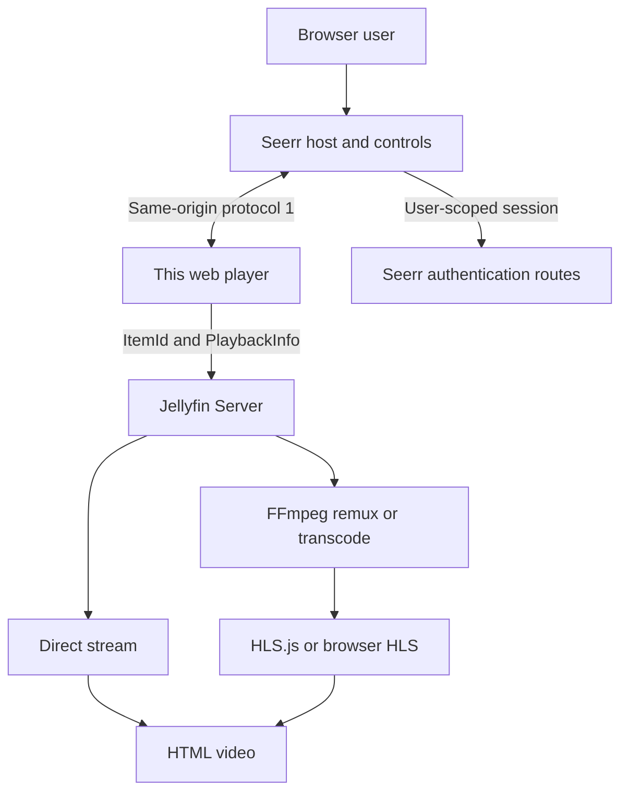
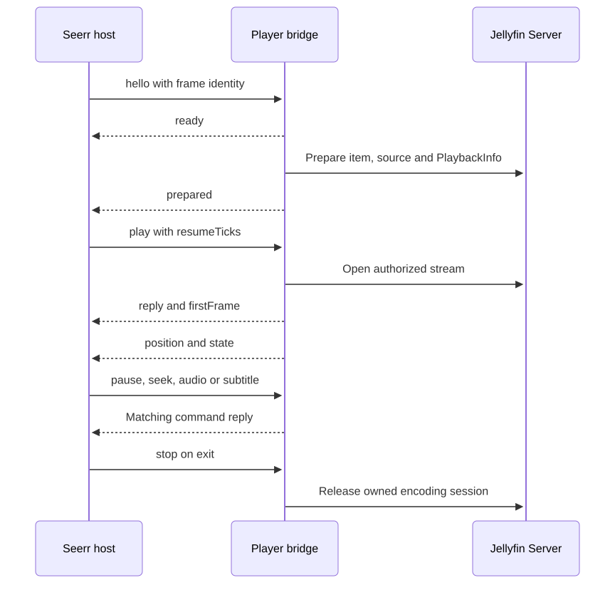
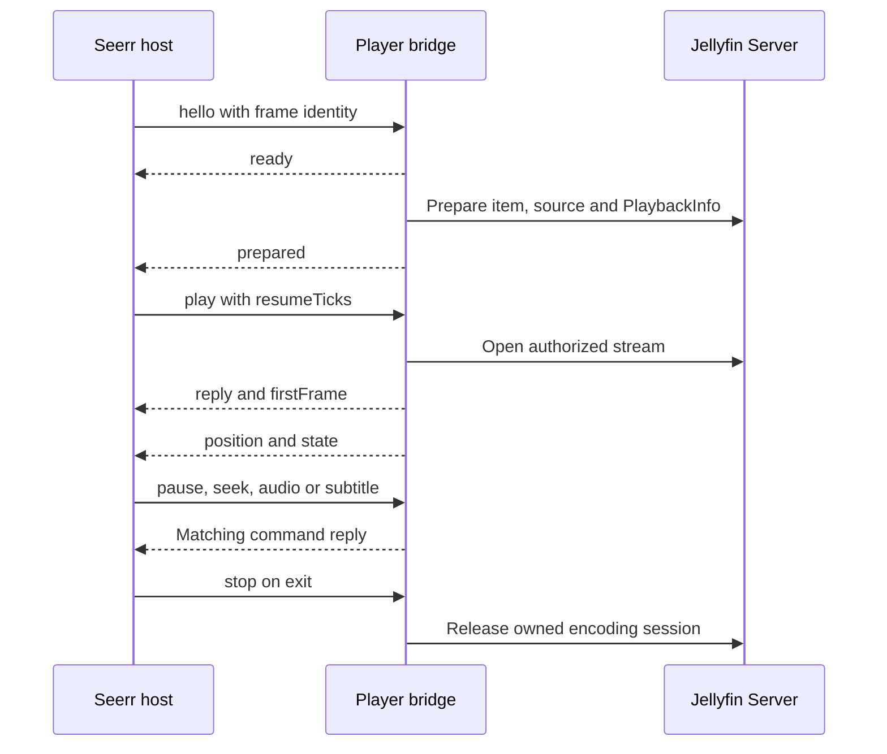

# Architecture and bridge

[Documentation](README.md) · [Development](development.md) · [Deployment](deployment.md)

## System overview

Mermaid diagram definition

Seerr owns profiles, watch history and the play overlay. Jellyfin retains media
selection, capability negotiation and streaming. Native TV uses another engine.

## Source map

| Source | Owns |
| --- | --- |
| [policy.js](../src/plugins/noah/policy.js) | Capabilities, profile decisions and preparation/PlaybackInfo caches |
| [embedded.js](../src/plugins/noah/embedded.js) | Preparation, first frame, cancellation, recovery and exact-session cleanup |
| [protocol.js](../src/plugins/noah/protocol.js) | Ordered commands, acknowledgments and frame/origin checks |
| [gestures.js](../src/plugins/noah/gestures.js) | Accumulated skip feedback and gestures |
| [casting.js](../src/plugins/noah/casting.js) | Source-bundled Cast sender transport |
| [style.scss](../src/plugins/noah/style.scss) | Embedded-player presentation |
| [HTML player](../src/plugins/htmlVideoPlayer/plugin.js) | Video element and actual playback |
| [Playback manager](../src/components/playback/playbackmanager.js) | Native playback orchestration |

Hooks are explicit calls from Jellyfin source. The guard rejects global browser
interception and selected SDK method replacement in core Noah modules. Hosts
without a bridge identity retain ordinary Jellyfin startup.

## Lifecycle

Mermaid diagram definition

Channel `noah-player`, version `1`: commands are `play`, `pause`, `resume`,
`seek`, `audio`, `subtitle`, `state`, `stop`. Messages carry `frameId` and command
`id`; both endpoints check source window and origin. Duplicate command IDs reuse
a reply. Commands are serialized; stop cancels a pending generation. Tokens are
not part of this contract. Resume input uses Jellyfin 100-nanosecond ticks;
snapshots use seconds.

## Performance boundaries

Preparation belongs to the selected media page. Embedded startup preserves one
initial bitrate decision and avoids synthetic bitrate probes. Direct Play is
preferred when capabilities permit; remuxing/transcoding handles incompatibility.
Subtitles can change that decision. HLS library and worker must match.
Source102 checks saw zero startup probes and at most one initial encoder; this
observation is not an instant-start guarantee.
