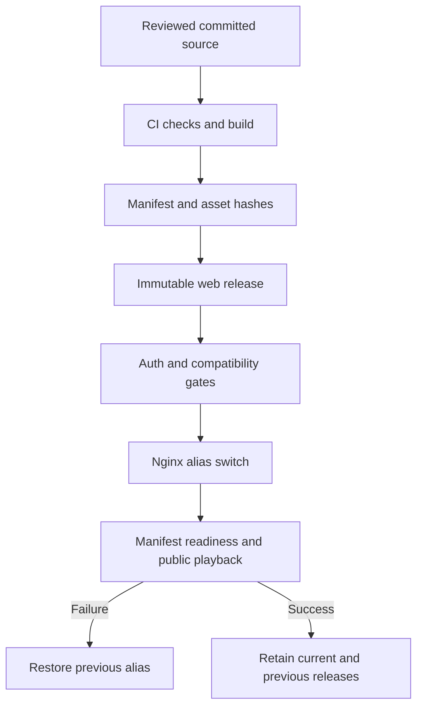

# Deployment and rollback

[Documentation](README.md) · [Updates](updates.md) · [Troubleshooting](troubleshooting.md)

This repository outputs a complete `dist/` directory. Production release
coordination belongs to the private integration repository.

Mermaid diagram definition

## Before switching

1. Require `check-and-build` on the exact source to deploy.
2. Verify every CI artifact asset against `noah-build.json`.
3. Pair protocol 1 with its Seerr host. Record source/image, server version,
   artifact ID, inventory hash and previous release directory.
4. Back up active routing. Keep the original web directory and previous chunks.
   Inspect the **active** vhost, not an unused config copy.
5. Exercise authenticated non-admin playback; a healthy homepage is insufficient.

The deployment gate rejects uncommitted candidate inventories. Never edit a
generated asset after creating the manifest.

## Serving contract

Serve `/player/web/` from the immutable release and proxy Jellyfin API/streams
under `/player/` on the same origin. Retain old lazy chunks for open clients;
fall back to the original web server when needed. The current operator setup
uses `Cache-Control: no-cache` for player assets; coordinate CDN changes with
manifest and rollback checks.

A web-only update leaves the Seerr image unchanged and does not restart its
container. Nginx reload is asynchronous: wait for the expected manifest with a
bounded deadline before accepting the switch.

## Verify and roll back

Check exact public source, old chunks, current user's scoped session, Direct
Play, HLS, pause/resume, advancing frames after seeks, subtitles and close.
Keep fixture history/report writes isolated.

On failure, restore the previous active alias, validate Nginx configuration and
reload it. Do not restore a database over subsequent user activity for a frontend
rollback. Keep old assets for active clients and rollback. The private release
record supplies exact host paths and backup IDs. Do not run legacy compiled-bundle
patch installers over source-built assets.
